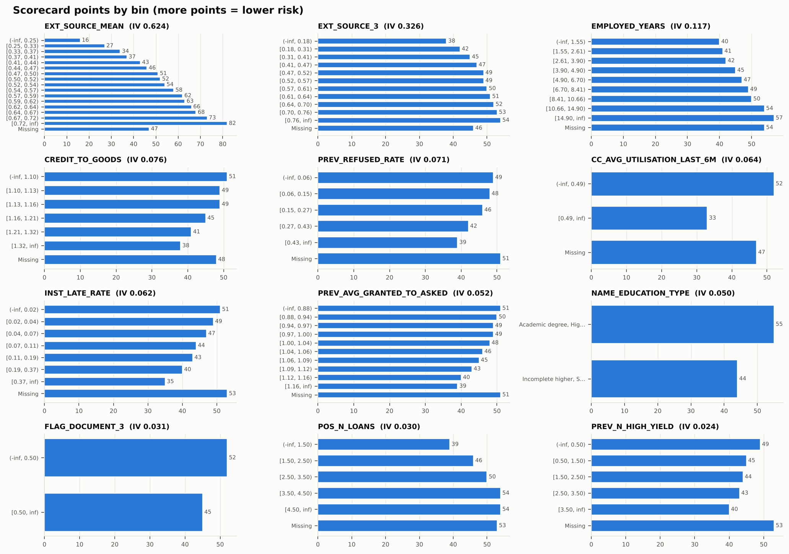

# Home Credit Risk Scorecard

**A bank-style credit scorecard (WOE/IV + logistic regression) vs XGBoost on the
Kaggle Home Credit Default Risk data, with a focus on the trade-off between
predictive power and the explainability regulators require.**

> **中文摘要**
> 這是一個信用風險建模作品集專案。資料來自 Kaggle Home Credit Default Risk（8 張關聯表、約 5,800 萬列）。
> 流程：用 **DuckDB SQL** 把多張歷史表聚合成每位申請人一列的特徵表 → 做 EDA 與 IV/PSI 篩選 → 建立銀行常用的 **WOE 分箱 + 邏輯斯迴歸評分卡** → 與 **XGBoost + SHAP** 比較 → 討論模型可解釋性、公平性與監理要求（如模型風險管理、拒貸理由說明）之間的取捨。
> 目前進度：
> - 第 1 階段（SQL 特徵層與 EDA）完成，詳見 [reports/01_data_and_eda.md](reports/01_data_and_eda.md)。
> - 第 2 階段（WOE/IV 評分卡）完成：12 個變數、保留樣本 AUC 0.752 / KS 0.379，並分析外部分數依賴、拒絕理由與公平性，詳見 [reports/02_scorecard.md](reports/02_scorecard.md)。

## Why this project

Banks still run most retail credit decisions on logistic scorecards, even though
gradient-boosted trees usually score higher on AUC. The reason is not ignorance:
regulators and model-risk teams need to know **why** an applicant was declined,
that the model is **stable** over time, and that it does not discriminate. This
project builds both models on the same data and makes that trade-off concrete.

## Results so far

| Stage | Status | Highlights |
|---|---|---|
| 1. SQL feature layer + EDA | ✅ done | 7 tables → 356k applicants × 194 features in DuckDB; IV and PSI screening |
| 2. WOE/IV logistic scorecard | ✅ done | 12-feature points card, hold-out AUC 0.752 / Gini 0.504 / KS 0.379, score PSI 0.007 |
| 3. XGBoost + SHAP, regulatory discussion | ⏳ next | performance vs explainability, fairness, adverse-action reasons |
| 4. Interactive dashboard | ⏳ | Streamlit app to score an applicant and explain the score |

Key findings from stage 1 ([full report](reports/01_data_and_eda.md)):

- **External bureau scores are the strongest signal** (IV 0.61 combined), which
  raises a governance question: the bank does not control how they are built.
- **Behaviour beats demographics**: past refusals, late installments and recent
  credit-seeking predict default better than income.
- **Income and debt-to-income are almost useless here** (IV ≈ 0.01), most likely
  a selection effect, since loan size was already set from income.
- **A severe population shift** (PSI > 1.3) in bureau_balance coverage between
  train and test means those features must not enter the model, a check that
  training AUC alone would never reveal.

Key findings from stage 2 ([full report](reports/02_scorecard.md)):

- **A 12-feature scorecard reaches AUC 0.752** on a 92k hold-out, is well
  calibrated, and its score barely drifts on the later Kaggle population (PSI 0.007).
- **Declining the lowest 15% stops 41% of defaults** and cuts the approved
  default rate from 8.1% to 5.5%.
- **The card leans on external scores**: they are the top decline reason for 99.9%
  of declines, and removing them costs 0.04 AUC, a model-risk issue in its own right.
- **Fairness**: gender (not a model input) passes the four-fifths rule, but
  applicants under 30 do not (ratio 0.75), through job tenure acting as a proxy.



## Repository layout

```
sql/
  staging/        cleaned application table (train + test)
  features/       one SQL file per source table, then the final join
src/hcrisk/
  build_features.py   load CSVs into DuckDB, run SQL, grain checks, export parquet
  eda.py              IV / PSI tables and figures
  scorecard.py        WOE binning, stepwise logistic, points, validation
reports/
  01_data_and_eda.md  stage 1 write-up
  02_scorecard.md     stage 2 write-up
  figures/  tables/
scripts/download_data.sh
```

Raw data and the DuckDB file live in `data/` and are git-ignored.

## Reproduce

Requirements: Python 3.10+, a Kaggle account with the
[competition rules](https://www.kaggle.com/c/home-credit-default-risk/rules)
accepted, and API credentials in `KAGGLE_USERNAME` / `KAGGLE_KEY` (or
`~/.kaggle/kaggle.json`).

```bash
make setup      # pip install
make data       # download + unzip into data/raw (~2.5 GB)
make features   # DuckDB load + SQL feature layer (~2 min)
make eda        # regenerate reports/figures and reports/tables
make scorecard  # stage 2 scorecard (~10 min)
```

## Tech stack

DuckDB (SQL), pandas, scikit-learn, statsmodels, optbinning, matplotlib; later
XGBoost, SHAP, Streamlit.

## Data

[Home Credit Default Risk](https://www.kaggle.com/c/home-credit-default-risk),
Kaggle competition data, used under the competition rules. The data is not
redistributed in this repository.
