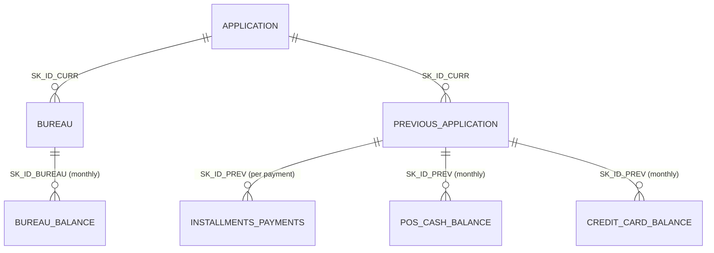
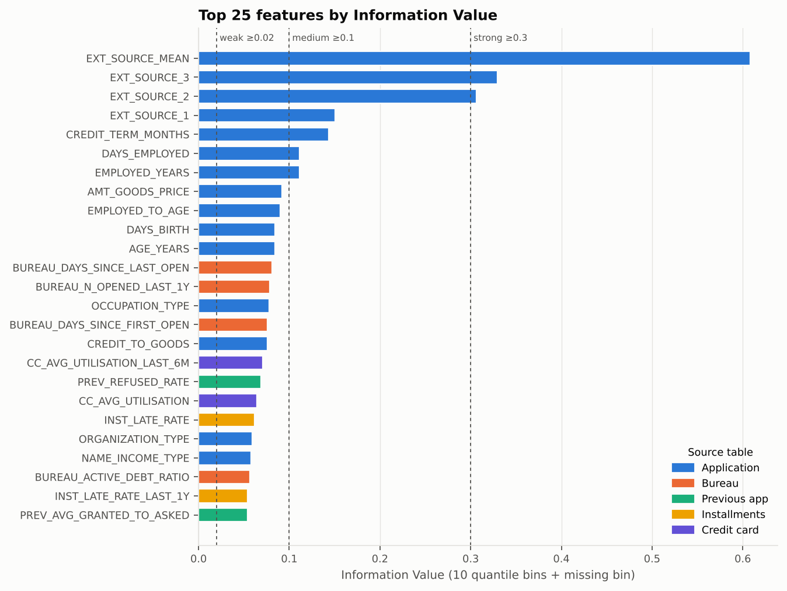
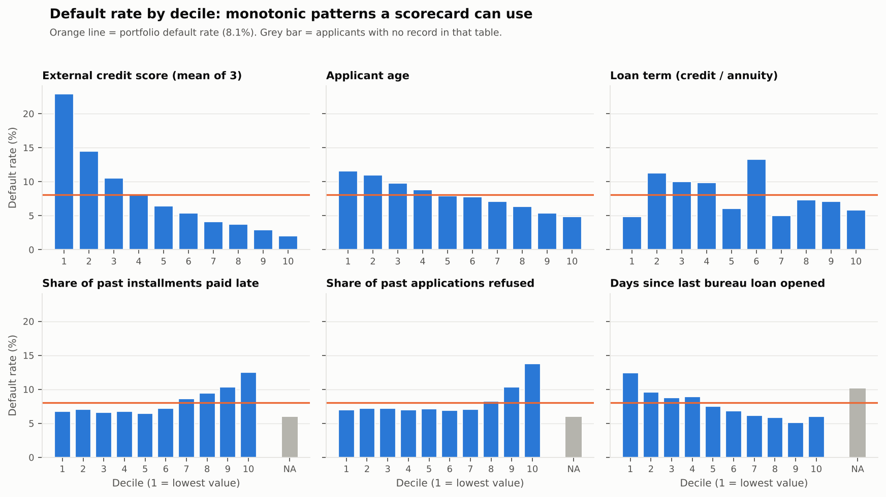
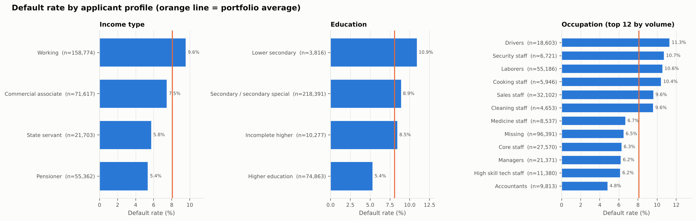
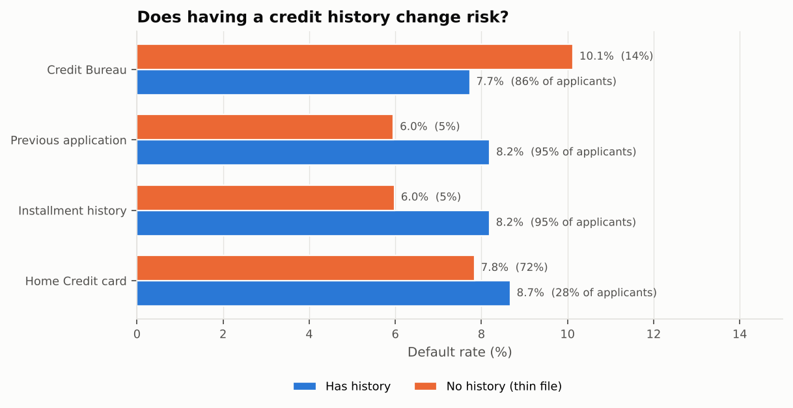
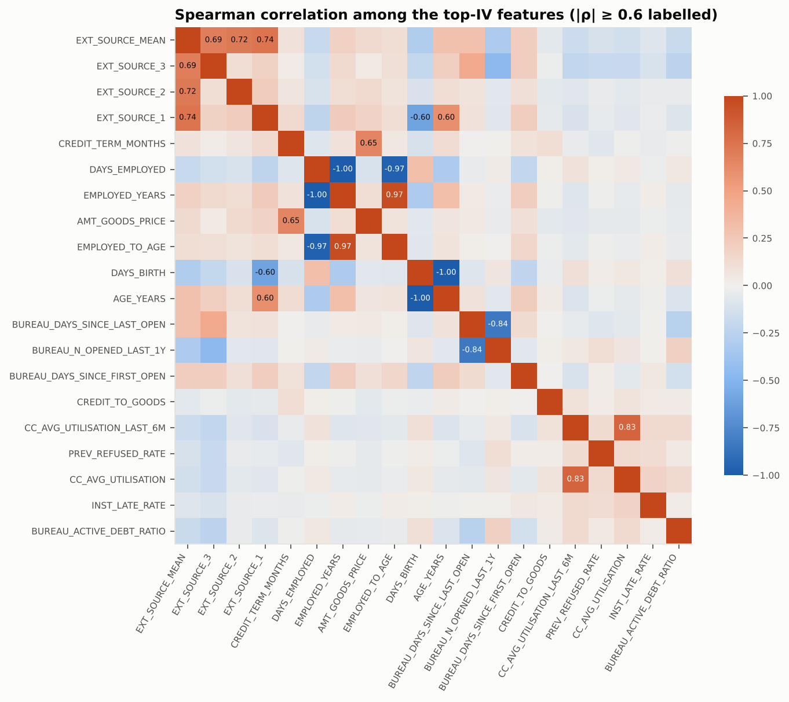
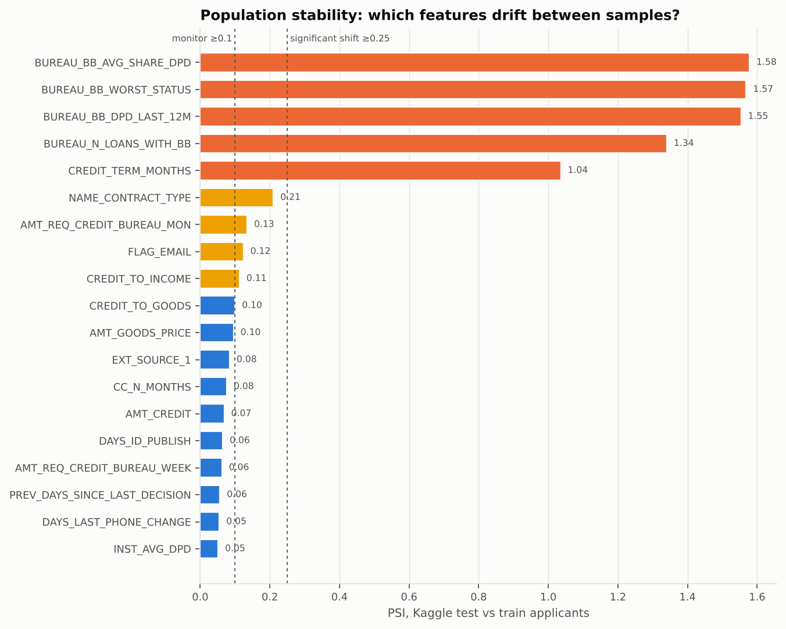

# 01 · Data, SQL Feature Layer and Exploratory Analysis

> **中文摘要**
> 本階段把 Home Credit 的 8 張關聯表（共約 5,800 萬列）載入 DuckDB，用 SQL 依「先聚合到正確粒度、再 LEFT JOIN 回申請人」的原則，產出一張 **每位申請人一列、194 個特徵** 的建模表，並以自動檢查確保每張特徵表的粒度正確。
> EDA 的重點發現：
> 1. **違約率 8.07%**，屬於典型的類別不平衡問題，評估時應看 AUC / KS / Gini，而非 accuracy。
> 2. **外部信用分數（EXT_SOURCE_1/2/3）是最強的變數**，平均後 IV 達 0.61。這不是資料洩漏，而是另一個評分模型的輸出；在監理上必須說明其來源，並避免過度依賴單一外部分數。
> 3. **年齡、就業年資、過去被拒件比例、過去逾期繳款比例** 都呈現單調關係，非常適合 WOE 分箱的評分卡。
> 4. **反直覺發現：收入、負債收入比（DTI）幾乎沒有預測力（IV < 0.02）**。可能原因是收入為申請人自報，且核貸額度原本就依收入設定（選擇偏誤）。
> 5. **母體穩定性（PSI）警訊**：Kaggle test 中有 bureau 紀錄的申請人幾乎 100% 有 bureau_balance 月資料，train 只有 35%；且 test 的循環信用比例從 9.5% 掉到 0.9%。因此 bureau_balance 衍生變數的 PSI > 1.3，**不應放進模型**。這正是銀行模型上線後監控（model monitoring）要抓的問題。
> 6. 性別有預測力（男 10.1% vs 女 7.0%），但依公平授信原則，**評分卡中將排除性別**，並在後續做公平性檢驗。

---

## 1. The data model

Home Credit lends to people with little or no credit history. The Kaggle dataset
has one main table and six history tables at four different grains.



| Table | Rows | Grain | What it tells us |
|---|---:|---|---|
| application_train / test | 307,511 / 48,744 | one loan application | applicant profile, loan terms, **TARGET** (train only) |
| bureau | 1,716,428 | one loan at another lender | external credit history |
| bureau_balance | 27,299,925 | bureau loan × month | monthly delinquency status of those loans |
| previous_application | 1,670,214 | one earlier Home Credit application | approvals, refusals, terms asked vs granted |
| installments_payments | 13,605,401 | one payment | paid on time? paid in full? |
| POS_CASH_balance | 10,001,358 | POS/cash loan × month | days past due per month |
| credit_card_balance | 3,840,312 | card × month | balance, limit, drawings, DPD |

`TARGET = 1` means the client had payment difficulties (late more than X days on
at least one of the first Y installments). Default rate in train: **8.07%**
(24,825 of 307,511).

## 2. SQL feature layer (DuckDB)

All feature engineering is plain SQL in [`sql/`](../sql), run in order by
[`src/hcrisk/build_features.py`](../src/hcrisk/build_features.py).

```
sql/staging/01_stg_application.sql      train + test, cleaned
sql/features/01_bureau.sql              bureau_balance -> bureau -> applicant
sql/features/02_previous_application.sql
sql/features/03_installments.sql
sql/features/04_pos_cash.sql
sql/features/05_credit_card.sql
sql/features/10_applicant_features.sql  LEFT JOIN everything -> 1 row per SK_ID_CURR
```

Design rules that matter, and the bugs they prevent:

1. **Aggregate to the right grain before joining.** Joining `bureau_balance`
   (27M rows) straight to the applicant would fan out rows and let loans with long
   histories dominate any average. It is first collapsed to one row per bureau
   loan, then to one row per applicant.
2. **Check for hidden grains.** `installments_payments` looks like one row per
   installment but is one row per *payment*: 13.6M rows cover 12.95M installments,
   because ~650k installments were paid in several parts. Treating every row as an
   installment would mark each partial payment as an "underpayment". The SQL
   first sums payments per `(SK_ID_PREV, NUM_INSTALMENT_VERSION, NUM_INSTALMENT_NUMBER)`.
3. **Keep the thin-file population.** Every join is a `LEFT JOIN`, and `HAS_*`
   flags record whether a history exists. 14% of applicants have no bureau record;
   dropping them would bias the model toward people who already have credit.
4. **Sentinels are not numbers.** `DAYS_EMPLOYED = 365243` (1,000 years) marks
   pensioners and the unemployed (18% of train). It becomes `NULL` plus a flag
   `FLAG_EMPLOYED_ANOMALY`, because the group itself is informative: its default
   rate is **5.4% vs 8.7%**. The same sentinel is cleaned in `previous_application`.
5. **No look-ahead.** Every `DAYS_*` / `MONTHS_BALANCE` column is relative to the
   current application date, so all history is, by construction, from before the
   decision. Recency windows (last 12 months) use the same reference point.
6. **Automated grain test.** The build asserts `COUNT(*) = COUNT(DISTINCT SK_ID_CURR)`
   for every feature table, so a bad join fails loudly instead of silently
   duplicating applicants.

Output: `applicant_features`, **356,255 rows × 194 features** (122 original
application columns + 72 engineered), built in about 90 seconds on 4 CPUs.

## 3. Which features carry signal? (Information Value)

Information Value (IV) is the standard univariate screening statistic in bank
scorecard development. Here every feature is cut into 10 quantile bins plus a
separate *missing* bin. This is a quick, unsupervised screen; the scorecard
step will replace it with supervised, monotonic binning.



| IV band (Siddiqi) | Count of features |
|---|---:|
| ≥ 0.5 "suspicious, check for leakage" | 1 |
| 0.3 – 0.5 strong | 2 |
| 0.1 – 0.3 medium | 4 |
| 0.02 – 0.1 weak | 82 |
| < 0.02 not predictive | 105 |

Reading the ranking:

- **External scores dominate.** `EXT_SOURCE_2/3` alone are "strong", and their
  mean reaches IV 0.61. An IV above 0.5 usually means leakage; here it does not.
  These are scores from external data providers, computed before the
  application. The real issue is a **governance** one: the bank does not know how
  these scores are built, so a regulator will ask what happens if the vendor
  changes its model. This becomes part of the model-risk discussion later.
- **Behaviour beats demographics.** Within the history tables, the top signals are
  behavioural: how recently the applicant opened credit elsewhere, the share of
  past Home Credit applications that were refused, card utilisation and the share
  of installments paid late.
- **Affordability ratios are surprisingly weak.** `CREDIT_TO_INCOME` (IV 0.010),
  `ANNUITY_TO_INCOME` (0.006) and income itself (0.011) barely separate good from
  bad. Two plausible reasons: income is self-declared, and loan size was already
  set with income in mind (the data only contains *approved* loans, a
  **selection effect** that hides the relationship). This is worth saying out loud
  in an interview, because the textbook answer would be "DTI is the key variable".

## 4. Shapes of the relationships



- External score, age, past-refusal share and late-payment share are **monotonic**.
  A logistic scorecard with WOE bins can capture them exactly, and the points
  will move in the direction a credit officer expects.
- **Loan term (credit ÷ annuity) is not monotonic.** Risk peaks around 20 months
  and is lowest for the shortest and longest terms. This likely reflects product
  mix (different products have different standard terms). A linear term in a
  logistic model would get this wrong; binning handles it, and a tree model finds
  it on its own. It is a concrete example for the scorecard vs XGBoost comparison.
- The grey **NA** bars are often different from every decile: applicants with no
  previous application default *less* (6.0%) than those with history. Missing is
  informative and gets its own WOE bin rather than imputation.



Salaried applicants ("Working", 9.6%) and those with lower secondary education
(10.9%) carry the most risk; pensioners (5.4%) and state servants (5.8%) the least. Occupation is missing for 31% of applicants,
and that group is lower risk than average (6.5%), mostly because pensioners have
no occupation.



Applicants **without a credit bureau record are riskier** (10.1% vs 7.7%), which
is the thin-file problem Home Credit exists to serve. In contrast, applicants
without previous Home Credit history are *less* risky, probably because new
customers pass a stricter first-time check.

## 5. Redundancy between features



Logistic regression coefficients become unstable with highly correlated inputs.
Pairs with |Spearman ρ| ≥ 0.6 among the top-20 features
([full list](tables/high_correlation_pairs.csv)) include the three external scores
vs their mean, `CC_AVG_UTILISATION` vs its 6-month version (0.83), and
`BUREAU_DAYS_SINCE_LAST_OPEN` vs `BUREAU_N_OPENED_LAST_1Y` (−0.84). The
`DAYS_*` vs `*_YEARS` pairs are the same variable in different units. The scorecard
step will keep one feature per correlated group (the higher-IV one) and check
VIF.

## 6. Population stability: train vs Kaggle test

Banks monitor the **Population Stability Index (PSI)** to see whether the
applicants scored today still look like the development sample. Treating Kaggle's
test set as a later "out-of-time" population:



- **bureau_balance features have PSI 1.3–1.6, a severe shift.** Among applicants
  with a bureau record, only **35%** in train have monthly bureau_balance data,
  versus **~100%** in test. A model that learned "no monthly data" patterns from
  train would see a completely different input mix in production. Decision:
  **exclude the `BUREAU_BB_*` features** from the scorecard, even though they look
  harmless in train.
- **Product mix changed.** Revolving loans fall from 9.5% of train to 0.9% of
  test, and median loan term from 20 to 16 months, which explains the shift in
  `NAME_CONTRACT_TYPE` (PSI 0.21) and `CREDIT_TERM_MONTHS` (PSI 1.04). The model
  will be validated per product, and term-related features need monitoring.

This is the kind of check that a model validation team or a regulator expects
before go-live, and it is easy to miss when you only look at training AUC.

## 7. Fairness note

`CODE_GENDER` has some predictive power (IV 0.039; men 10.1% vs women 7.0%).
Using a protected attribute in a credit decision is not acceptable under fair
lending principles (e.g. the Taiwan FSC's Treating Customers Fairly principles,
the US Equal Credit Opportunity Act, EU anti-discrimination law). It will be **excluded** from both models,
and the scorecard step will test whether other features act as proxies by
comparing approval rates across groups.

## 8. Decisions carried into modelling

| Decision | Reason |
|---|---|
| Drop `BUREAU_BB_*` features | PSI > 1.3 between train and test |
| Drop `CODE_GENDER` | fair lending; checked later for proxies |
| Keep missing as its own WOE bin | missingness is informative (thin file, no prior applications) |
| One feature per correlated group | stable logistic coefficients |
| Monotonic supervised binning for the scorecard | most top features are monotonic; enforces intuitive points |
| Evaluate with AUC, KS, Gini, calibration | 8% default rate, so accuracy is meaningless |
| Use a stratified hold-out from train; treat Kaggle test only as a stability sample | Kaggle test has no labels |

## Reproduce

```bash
pip install -r requirements.txt && pip install -e .
./scripts/download_data.sh             # needs Kaggle API credentials + accepted rules
python -m hcrisk.build_features        # DuckDB load + SQL feature layer (~2 min)
python -m hcrisk.eda                   # figures/ and tables/ in this folder
```
