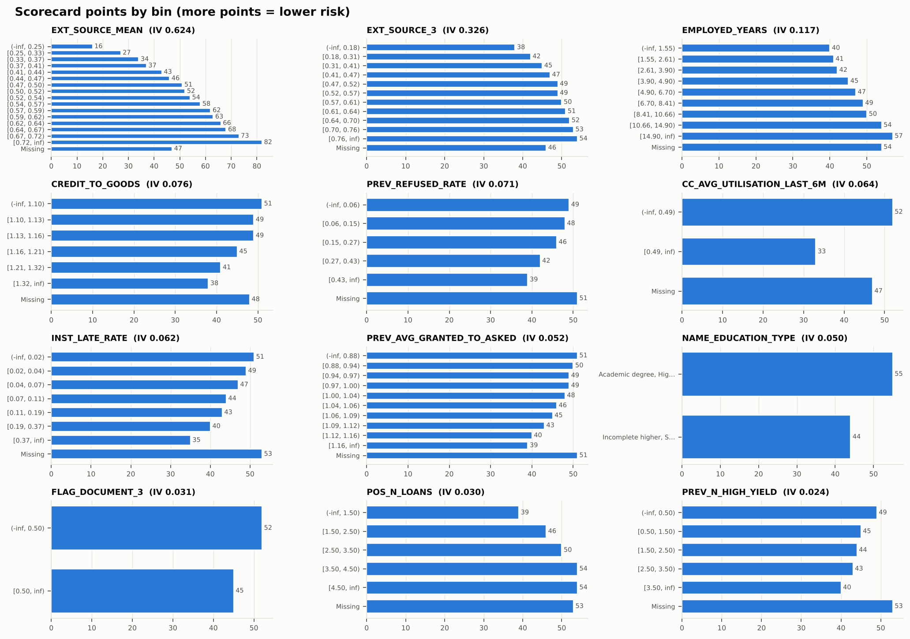
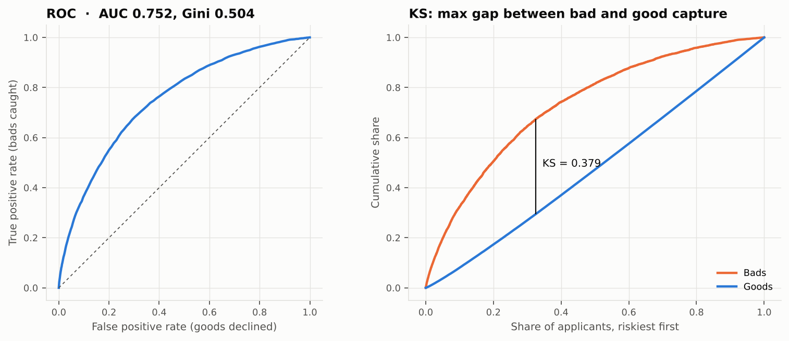
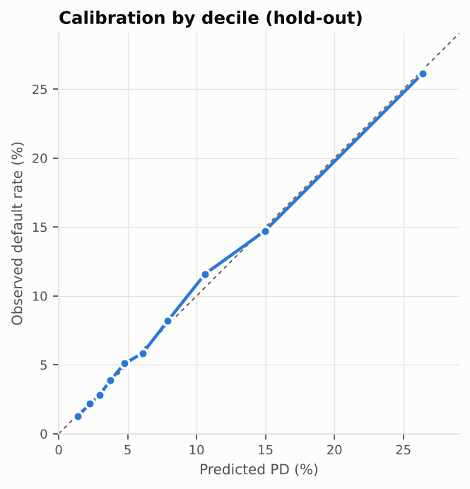
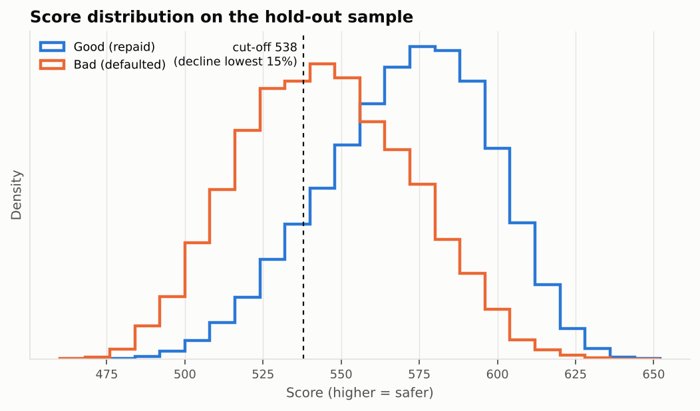

# 02 · WOE/IV Logistic Scorecard

> **中文摘要**
> 本階段建立銀行常用的申請評分卡（application scorecard）：以 optbinning 做**監督式、單調的最佳分箱**，轉成 WOE 後用邏輯斯迴歸建模，最後換算成「600 分 = 好壞比 50:1、每 20 分好壞比加倍（PDO）」的整數點數表。
> - **變數篩選流程**：186 個候選 → 穩定性（PSI ≤ 0.25）→ IV ≥ 0.02（85 個）→ WOE 相關性 ≤ 0.6（43 個）→ 逐步選取（forward stepwise），並要求每個係數方向符合業務直覺 → 最終 **12 個變數**，全部 p < 0.001、VIF < 1.6。
> - **成效（30% 保留樣本）**：**AUC 0.752、Gini 0.504、KS 0.379**，訓練與保留樣本幾乎一致（無過擬合）；校準曲線貼近 45 度線；分數 PSI 僅 0.007，模型穩定。
> - **授信政策模擬**：拒絕分數最低 15%（cut-off 538 分），可擋下 **41% 的違約戶**，核准戶違約率由 8.1% 降至 **5.5%**。
> - **治理與監理議題**：
>   1. **過度依賴外部分數**：EXT_SOURCE_MEAN 是 99.9% 拒件案件的首要拒絕理由；若移除外部分數，AUC 從 0.752 降到 0.714。外部供應商模型若改版，評分卡會受到直接衝擊，需要列入模型風險管理。
>   2. **拒絕理由（reason codes）**：每位申請人都能用「相對於最高分少了幾分」列出前三個拒絕理由，滿足消費者保護對「說明拒貸原因」的要求。
>   3. **公平性**：模型未使用性別，男女核准率比 0.95，通過 4/5 原則；但 30 歲以下族群核准率比僅 **0.75（低於 0.8）**，即使年齡不在模型中，就業年資等變數仍會產生代理效果，需要業務與法遵共同判斷是否合理。

---

## 1. Why a scorecard?

A points-based scorecard is still the default for retail credit decisions because:

- **Every point is explainable.** A credit officer can read the whole model on
  one page and see why an applicant scored 522.
- **Monotonic by design.** Binning forces "more late payments = fewer points",
  so the model can never reward risky behaviour because of noise.
- **Regulators know how to validate it.** Model risk management guidance
  (e.g. the US Federal Reserve's SR 11-7 and the Basel IRB requirements)
  asks for conceptual soundness, stability, and reasons for adverse decisions.
  A scorecard answers those directly.

The cost is predictive power, which stage 3 will measure against XGBoost.

## 2. Pipeline

Code: [`src/hcrisk/scorecard.py`](../src/hcrisk/scorecard.py). Run with
`python -m hcrisk.scorecard` (~10 minutes on 4 CPUs).

**Samples.** The 307,511 labelled applications are split 70/30 (stratified on
default) into a **development** sample and a **hold-out** sample that is touched
only once, for the final numbers. Inside development, a further 80/20 split gives a
*fit* and a *validation* fold, so feature selection is judged on data the
coefficients did not see. The unlabelled Kaggle test set is used only to measure
stability.

### 2.1 Feature funnel

| Step | Rule | Features left |
|---|---|---:|
| Start | stage-1 feature layer | 194 |
| Stage-1 exclusions | drop `CODE_GENDER` (fair lending), `BUREAU_BB_*` (coverage shift), raw `DAYS_*` duplicates | 187 |
| Stability | PSI (Kaggle test vs train) ≤ 0.25; drops `CREDIT_TERM_MONTHS` (PSI 1.04) | 186 |
| Supervised binning + IV | optimal monotonic bins (each bin ≥ 5% of applicants), IV ≥ 0.02 | 85 |
| Redundancy | \|Pearson r\| between WOE values ≤ 0.6, keep the higher-IV feature | 43 |
| Forward stepwise | add the feature that most improves validation AUC; stop when the gain < 0.0015 or a coefficient has the wrong sign | **12** |

Examples of what the redundancy filter removed
([full list](tables/corr_drops.csv)): `EXT_SOURCE_2` (r = 0.72 with the mean
score), `PREV_N_REFUSED` (0.84 with `PREV_REFUSED_RATE`), `INST_AVG_DPD` (0.89 with
`INST_LATE_RATE`).

**What the stability rule cost.** Adding the unstable `CREDIT_TERM_MONTHS` back
raises hold-out AUC only from 0.7519 to 0.7525. Giving up 0.0006 AUC for a model
that will not drift when the product mix changes is an easy trade.

### 2.2 Binning

`optbinning` solves for the bins that maximise IV, under these constraints:

- the bad rate is **monotonic** across bins (ascending, descending, or a single
  peak/valley where the data clearly supports it);
- every bin holds at least 5% of applicants, so no point value rests on a handful
  of cases;
- **missing values get their own bin** with their own WOE.

One detail mattered. With a rare-category cut-off, "Academic degree" (164
applicants, 0.05%) became its own bin with an extreme WOE worth 78 points, more
than any other education level. Removing the cut-off lets the optimiser merge it
with "Higher education", which is both statistically safer and easier to defend.

### 2.3 Logistic regression on WOE

| Feature | What it measures | IV | Coef. | VIF |
|---|---|---:|---:|---:|
| EXT_SOURCE_MEAN | average of the external credit scores | 0.624 | −0.76 | 1.60 |
| EXT_SOURCE_3 | one external score, kept for extra signal | 0.326 | −0.25 | 1.57 |
| EMPLOYED_YEARS | years in current employment | 0.117 | −0.57 | 1.04 |
| CREDIT_TO_GOODS | loan amount ÷ price of goods financed | 0.076 | −0.58 | 1.05 |
| PREV_REFUSED_RATE | share of past Home Credit applications refused | 0.071 | −0.45 | 1.07 |
| CC_AVG_UTILISATION_LAST_6M | card balance ÷ limit, last 6 months | 0.064 | −0.65 | 1.02 |
| INST_LATE_RATE | share of past installments paid late | 0.062 | −0.70 | 1.06 |
| PREV_AVG_GRANTED_TO_ASKED | amount granted ÷ amount asked on past loans | 0.052 | −0.54 | 1.02 |
| NAME_EDUCATION_TYPE | education level | 0.051 | −0.67 | 1.04 |
| FLAG_DOCUMENT_3 | whether document 3 was provided | 0.032 | −0.60 | 1.04 |
| POS_N_LOANS | number of past POS / cash loans | 0.030 | −1.18 | 1.33 |
| PREV_N_HIGH_YIELD | number of past high-interest loans | 0.024 | −0.69 | 1.39 |

All coefficients are negative, as they must be: WOE is positive for safer bins, so
a higher WOE lowers the predicted default probability. All p-values are below
1e-20 and every VIF is below 1.6, so the coefficients are stable.

Six of the twelve features come from the SQL history tables, which shows the
value of the stage-1 joins: application-form data alone would not get here.

`FLAG_DOCUMENT_3` is the one feature a credit committee would challenge: the data
dictionary does not say what document 3 is. In a real bank it would either be
explained by the business or removed. It is kept here to show the question being
asked, not as an endorsement.

## 3. From coefficients to points

The model's log-odds are scaled to a points system:

- **600 points = odds of 50 : 1** (good : bad), i.e. a PD of about 2%;
- **every 20 points doubles the odds** (PDO = 20).

With `factor = 20 / ln 2` and `offset = 600 − factor · ln 50`, each bin is worth

```
points = −(β · WOE + β₀ / n) · factor + offset / n
```

rounded to an integer, where *n* = 12 features. An applicant's score is the sum
of their 12 bin values, from **446 to 665** in practice.



The external score has by far the widest range (16 to 82 points, a 66-point
spread). Every other feature moves the score by 7 to 19 points. The full table
is in [`tables/scorecard_points.csv`](tables/scorecard_points.csv).

## 4. Validation (hold-out, 92,254 applicants)

| Sample | AUC | Gini | KS |
|---|---:|---:|---:|
| Development | 0.751 | 0.502 | 0.376 |
| **Hold-out** | **0.752** | **0.504** | **0.379** |

Development and hold-out performance are the same, so the model is not
overfitted. A Gini around 0.50 is typical for an application scorecard on a
thin-file population.



**Calibration.** The predicted PD follows the observed default rate across all
ten deciles, so the score can be read directly as a probability (important if it
feeds pricing or IFRS 9 provisions).



**Rating grades.** Banks present a score as a small number of grades with a
clear risk ordering. Eight equal-sized grades on the hold-out:

| Grade | Score range | Applicants | Default rate |
|---|---|---:|---:|
| A | 600 – 648 | 11,271 | 1.4% |
| B | 589 – 599 | 11,675 | 2.4% |
| C | 580 – 588 | 11,380 | 3.3% |
| D | 571 – 579 | 11,771 | 4.8% |
| E | 562 – 570 | 10,900 | 6.1% |
| F | 551 – 561 | 11,413 | 8.9% |
| G | 536 – 550 | 11,737 | 12.9% |
| H | 464 – 535 | 12,107 | 23.7% |

Default rate rises steadily from A to H, with a 17× spread between the best
and the worst grade.

**Stability.** Score PSI is 0.0001 between development and hold-out and
**0.007 between development and the Kaggle test population**, well under the
0.1 monitoring threshold. The stage-1 decision to drop the shifting bureau_balance
features pays off here.

## 5. Using the score: a cut-off decision



As an illustration, decline the lowest-scoring 15% (cut-off **538**):

| | Value |
|---|---:|
| Approval rate | 85.4% |
| Default rate, all applicants | 8.1% |
| Default rate, approved | **5.5%** |
| Default rate, declined | 22.9% |
| Share of all defaulters declined | **41%** |

The right cut-off depends on the margin on a good loan and the loss on a bad one.
Stage 3 will add a profit curve to choose it.

## 6. Reason codes (why was I declined?)

Consumer-protection rules expect a lender to tell a declined applicant the main
reasons (e.g. adverse-action notices under the US ECOA, and the Taiwan FSC's
Treating Customers Fairly principles). A
scorecard provides them directly: for each feature, compare the applicant's
points with the maximum available, and report the features with the largest
shortfall.

Example, applicant 249287, score 522 (declined):

| Reason | Applicant's value | Points | Max points | Shortfall |
|---|---|---:|---:|---:|
| 1. External credit score | 0.37 | 37 | 82 | 45 |
| 2. Share of installments paid late | 62.5% | 35 | 53 | 18 |
| 3. External score 3 | 0.10 | 38 | 54 | 16 |

**Finding: one variable drives almost every decline.** The external score is the
top reason for **99.9% of declined applicants**, because its points range is
three to four times wider than any other feature. For a customer, "your external
credit score is low" is not actionable, and the lender cannot explain how that
score was built. This is the strongest argument for the challenger below.

## 7. Governance check: dependence on the external scores

The same pipeline, re-run with every `EXT_SOURCE_*` feature removed, selects 15
features from internal and bureau data (age, recent bureau enquiries, late
installments, education, employment, past refusals, region rating, card
utilisation, …):

| Model | Hold-out AUC | Gini | KS |
|---|---:|---:|---:|
| Scorecard with external scores | 0.752 | 0.504 | 0.379 |
| Scorecard **without** external scores | 0.714 | 0.428 | 0.311 |

The external scores are worth about **0.04 AUC (0.08 Gini)**. That is a material
dependency on a model the bank does not own. A model risk team would ask for:
vendor documentation, monitoring of the external score's own PSI, and a fallback
(the internal-only card above) if the vendor changes or stops the score.

## 8. Fairness check

Gender is not a model input, but the outcome can still differ by gender through
correlated features. At the 538 cut-off:

| Group | Applicants | Approval rate | Adverse impact ratio | Default rate if approved |
|---|---:|---:|---:|---:|
| Female | 60,839 | 86.9% | 1.00 | 4.8% |
| Male | 31,412 | 82.6% | **0.95** | 7.1% |

The adverse impact ratio (each group's approval rate ÷ the highest group's) is
above the common **four-fifths (0.8) rule**. The gap that remains is explained by
risk: approved men still default more often (7.1% vs 4.8%), so the model is not
being unfair to them.

Age tells a different story:

| Age | Approval rate | Adverse impact ratio | Default rate |
|---|---:|---:|---:|
| < 30 | 70.2% | **0.75** | 11.3% |
| 30 – 39 | 82.9% | 0.89 | 9.7% |
| 40 – 49 | 88.4% | 0.94 | 7.5% |
| 50 – 59 | 91.0% | 0.97 | 6.2% |
| 60 + | 93.6% | 1.00 | 5.0% |

Age is **not** in the scorecard, yet applicants under 30 fall below the 0.8
threshold, through `EMPLOYED_YEARS` (young people have short job tenure) and the
external scores. Their higher default rate (11.3%) means the score is
risk-consistent, so this is not necessarily unlawful (US ECOA, for example, allows
age-related factors in an empirically derived system as long as older applicants
are not disadvantaged). But it is a decision for the business and compliance
teams, not for the modeller alone. Options include a separate young-applicant
strategy, a lower cut-off with smaller limits, or accepting the gap with
documented justification.

## 9. Summary for the model committee

| Question | Answer |
|---|---|
| Is it accurate? | AUC 0.752 / Gini 0.50 / KS 0.38 on the hold-out, no overfitting |
| Is it calibrated? | yes, predicted PD matches observed default by decile |
| Is it stable? | score PSI 0.007 vs the later Kaggle population |
| Can we explain each decision? | yes, integer points and top-3 reason codes |
| Is it fair? | gender passes the 4/5 rule; under-30s do not, needs a policy decision |
| Main risk | 0.04 AUC depends on external scores the bank does not control |

**Next (stage 3):** train XGBoost on the same samples, explain it with SHAP, and
compare accuracy, stability, reason codes and fairness side by side, to show what
the scorecard gives up and what it gains.

## Reproduce

```bash
pip install -r requirements.txt && pip install -e .
python -m hcrisk.build_features   # if data/processed is empty (see stage 1)
python -m hcrisk.scorecard        # ~10 min; writes figures/ and tables/
```
