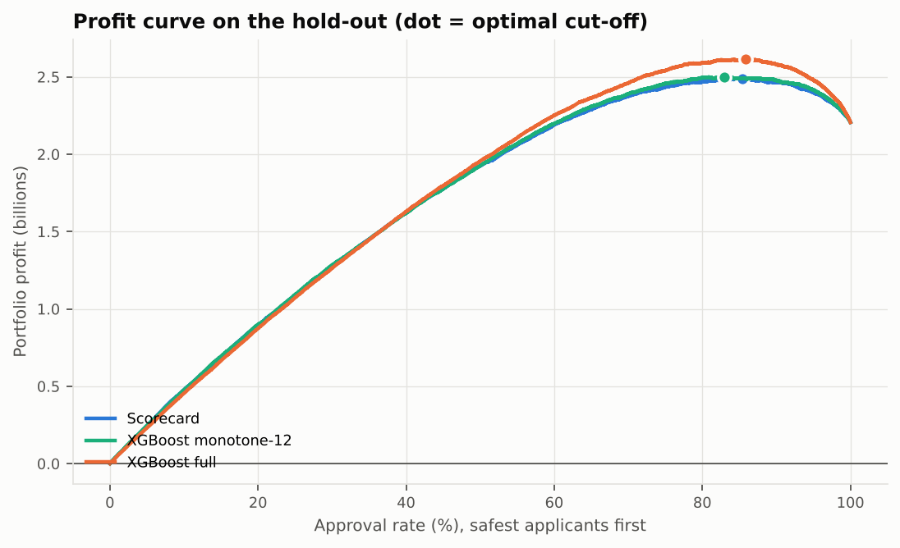
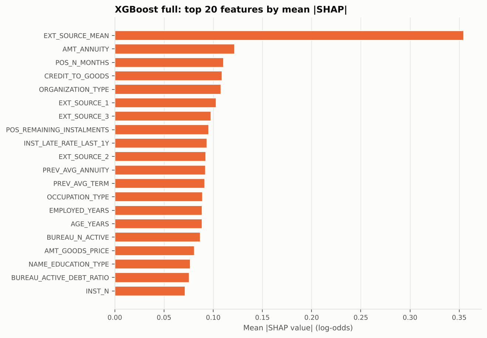
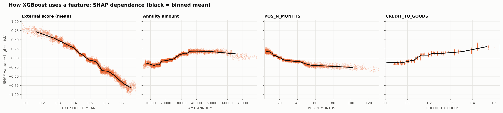
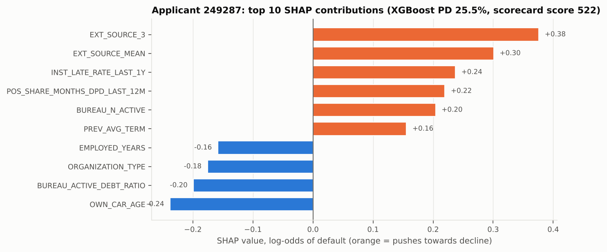

# 03 · Scorecard vs XGBoost: Accuracy, Explainability and Regulation

> **中文摘要**
> 本階段在**完全相同的訓練／保留樣本**上訓練兩個 XGBoost，與第 2 階段的評分卡比較：
> - **XGBoost monotone-12**：只用評分卡的 12 個變數，並加上與評分卡同方向的單調限制 → 用來區分「演算法」本身的貢獻。
> - **XGBoost full**：使用全部 186 個穩定特徵、不加限制 → 代表「機器學習最大潛力」。
>
> 主要結果（保留樣本 92,254 人）：
> | 模型 | AUC | KS | 拒絕 15% 時擋下的違約戶 | 最大利潤（相對評分卡）|
> |---|---|---|---|---|
> | 評分卡 | 0.752 | 0.379 | 41.3% | 基準 |
> | XGBoost monotone-12 | 0.756 | 0.386 | 42.5% | +0.5% |
> | XGBoost full | **0.786** | **0.431** | **47.9%** | **+5.1%** |
>
> 解讀：
> 1. **同樣 12 個變數時，XGBoost 只比評分卡多 0.004 AUC**，代表評分卡的 WOE 分箱已經把這些變數的非線性關係抓得差不多；**真正的提升來自「用更多特徵」**（+0.03 AUC）。
> 2. 三個模型的校準、穩定性（PSI ≤ 0.007）與公平性（性別、年齡的核准率比）都相近，XGBoost 並沒有比較「不公平」或「不穩定」。
> 3. **可解釋性的代價**：XGBoost full 需要 46 個特徵才能解釋 80% 的 SHAP 貢獻；12 個評分卡變數中有 5 個的效果方向會在不同區間反轉；評分卡拒絕的人中有 30% 會被 XGBoost 核准；而且模型可能用 AMT_ANNUITY 與 AMT_GOODS_PRICE「重建」我們因穩定性而刪掉的貸款期數變數。
> 4. **監理面**：歐盟 AI Act 將個人信用評分列為高風險 AI；美國 ECOA／CFPB 要求「具體」的拒貸理由，複雜模型不能豁免；台灣金管會《金融業運用人工智慧(AI)指引》強調可解釋性與公平性。SHAP 可以提供個別理由，但它是對模型的「近似說明」，驗證成本高。
> 5. **建議**：以評分卡作為核准決策的**主模型（champion）**，XGBoost 作為**挑戰者模型（challenger）**，用來發掘評分卡漏掉的特徵（如 POS 還款月數、月付金額）、做監控與分群策略；若要直接上線 XGBoost，應採用單調限制版本並建立 SHAP 拒貸理由流程。

---

## 1. Setup

Code: [`src/hcrisk/compare.py`](../src/hcrisk/compare.py), run with
`python -m hcrisk.compare` after the scorecard (about 25 minutes on 4 CPUs).

All three models use **exactly the same samples** as stage 2 (the script asserts
the hold-out IDs match): 215k development applicants, of which 80% are used to fit
and 20% to choose hyperparameters with early stopping, and the same 92k hold-out.

| Model | Inputs | Constraints | Purpose |
|---|---|---|---|
| **A. Scorecard** | 12 WOE-binned features | monotonic bins, integer points | the bank standard (stage 2) |
| **B. XGBoost monotone-12** | the same 12 features, raw values | monotone in the scorecard's direction | isolates the gain from the *algorithm* |
| **C. XGBoost full** | all 186 stable candidates (same stage-1 and PSI exclusions) | none | the gain from algorithm **plus** all features |

XGBoost: histogram trees, learning rate 0.05, row subsample 0.8, column subsample
0.5, L2 = 5, native categorical handling. Depth 3 to 5 was compared on the
validation fold; depth 3 won for both models (667 and 1,505 trees). Gender stays
excluded from every model.

## 2. Accuracy

| Model | Hold-out AUC | Gini | KS | Development AUC | Brier |
|---|---:|---:|---:|---:|---:|
| A. Scorecard | 0.752 | 0.504 | 0.379 | 0.751 | 0.0684 |
| B. XGBoost monotone-12 | 0.756 | 0.512 | 0.386 | 0.759 | 0.0681 |
| C. XGBoost full | **0.786** | **0.571** | **0.431** | 0.831 | **0.0660** |

Two separate effects:

- **Algorithm alone (A → B): +0.004 AUC.** Given the same 12 variables, gradient
  boosting barely beats a binned logistic model. The WOE bins already capture the
  non-linear shape of each variable, and with 12 roughly independent inputs there
  are few interactions left to find.
- **More features (B → C): +0.030 AUC.** The real gain comes from letting the
  model use 186 features at once, including many weak ones that stepwise selection
  rejected one at a time.

The full model's development AUC (0.831) is well above its hold-out AUC. That gap
is normal for boosting and is why every decision here uses the hold-out.

## 3. Does the extra AUC make money?

AUC is not a business metric. The profit curve uses deliberately simple, stated
assumptions: an approved good loan earns **8%** of the credit amount over its life,
and an approved bad loan loses **45%** of it (the Basel foundation-IRB LGD for
senior unsecured exposures). Applicants are approved from safest to riskiest.



| Model | Optimal approval rate | Max profit | vs scorecard | Defaulters caught at 15% decline | Default rate of approved |
|---|---:|---:|---:|---:|---:|
| A. Scorecard | 85.4% | 2.487 bn | – | 41.3% | 5.55% |
| B. XGBoost monotone-12 | 83.0% | 2.499 bn | +0.5% | 42.5% | 5.46% |
| C. XGBoost full | 85.8% | **2.614 bn** | **+5.1%** | **47.9%** | **4.95%** |

On this hold-out, the full model is worth about 5% more profit, roughly
**126 million** in the local currency on 92k applications. Scaled to a real loan book,
that is a material number, and it is why the question "why not use XGBoost?"
is a fair one.

## 4. Calibration, stability and fairness: no clear loser

| Model | Mean PD ÷ actual default rate | Score PSI, Kaggle test vs development |
|---|---:|---:|
| A. Scorecard | 0.99 | 0.007 |
| B. XGBoost monotone-12 | 1.00 | 0.007 |
| C. XGBoost full | 0.99 | 0.005 |

All three are well calibrated on average and stable on the later population
(PSI far below 0.1), because the unstable features were removed before any model
saw them.

Fairness at the same policy (decline the riskiest 15%), using the adverse impact
ratio (approval rate ÷ best group's approval rate):

| Group | Scorecard | XGBoost monotone-12 | XGBoost full |
|---|---:|---:|---:|
| Male vs female | 0.95 | 0.94 | 0.92 |
| Age < 30 | 0.75 | 0.73 | 0.77 |
| Age 30–39 | 0.89 | 0.86 | 0.85 |

The black-box model is **not** more biased here: the under-30 gap exists in all
three, because young applicants really do default more (11.3%) and every model
picks that up through job tenure, credit history length and the external scores.
The male/female ratio drops a little with XGBoost but stays above 0.8. Fairness is
a property of the data and the policy as much as of the algorithm.

## 5. Explaining XGBoost with SHAP

SHAP (SHapley Additive exPlanations) splits each prediction into a contribution
per feature, in log-odds, so that the contributions plus a base value add up to
the model's output. For tree models it is exact and fast (TreeSHAP, computed here
with XGBoost's native `pred_contribs`).

### 5.1 Global: which features matter?



The external score still leads, but the influence is spread thin: the top feature
carries **8.7%** of total |SHAP|, the top 10 only **31%**, and it takes **46
features** to account for 80%. A model committee would need to review 46
variables, against 12 for the scorecard.

### 5.2 Shape: how is each feature used?



- **External score**: smooth and monotonic, the same story as the scorecard.
- **Annuity amount (`AMT_ANNUITY`)**: risk rises with the monthly payment up to
  about 35k and then flattens. Combined with `AMT_GOODS_PRICE` and `AMT_CREDIT`,
  which are also in the model, this lets the trees **reconstruct the loan term
  (credit ÷ annuity), the feature that was removed in stage 2 for instability
  (PSI 1.04).** The final score is still stable on the Kaggle test set (PSI 0.005),
  but a validator would want this documented, because the ratio is now hidden
  inside the trees rather than visible and monitored.
- **POS_N_MONTHS** (length of point-of-sale loan history): a longer history means
  lower risk. Stepwise selection never picked it for the scorecard, which makes it
  a candidate to add.

**Monotonicity.** For the 11 numeric scorecard features, the binned SHAP mean of
the full model changes direction across deciles for five of them (for example
twice for `EXT_SOURCE_3` and `PREV_AVG_GRANTED_TO_ASKED`). Most reversals are small,
but each one is a case where the model can say "a higher value is safer" in one
range and "riskier" in another. The scorecard rules this out by construction;
model B shows it can be enforced in XGBoost too, at almost no cost in AUC.

### 5.3 Local: one applicant

The same applicant used in stage 2 (ID 249287, scorecard score 522, declined):



| | Scorecard reasons (points below max) | XGBoost SHAP (largest risk-increasing) |
|---|---|---|
| 1 | External score mean (−45 points) | External score 3 (+0.38) |
| 2 | Installments paid late (−18) | External score mean (+0.30) |
| 3 | External score 3 (−16) | Installments late, last 12 months (+0.24) |

The reasons agree on substance. Across all applicants that **both** models decline,
the scorecard's top reason is among XGBoost's top three SHAP reasons **91%** of
the time.

But the two models do not decline the same people: only **70%** of the
scorecard's declines are also declined by XGBoost full. Switching models would
change the decision for about three in ten of today's declines, which is itself
something a bank must be able to justify.

## 6. What regulators ask, and how each model answers

| Requirement | Where it comes from | Scorecard | XGBoost + SHAP |
|---|---|---|---|
| Specific reasons for a decline | US ECOA / Reg B adverse-action notices; CFPB Circular 2022-03 (complex models are no excuse); GDPR Art. 13–15 & 22 "meaningful information about the logic" | points below maximum, exact and the same for everyone | SHAP gives per-applicant reasons, but they explain the model only locally and depend on the background data |
| Conceptual soundness, independent validation | US SR 11-7 model risk management; Basel IRB use test | 12 variables, monotonic, readable on one page | 186 inputs, 1,505 trees; validation needs SHAP, PDPs, stress tests |
| High-risk AI obligations | EU AI Act (credit scoring of natural persons is high-risk, Annex III): data governance, documentation, human oversight, accuracy and robustness | straightforward to document | achievable, but documentation and monitoring cost is much higher |
| Fairness and explainability principles | Taiwan FSC *Guidelines for the Use of AI in the Financial Industry* (2024); FSC Treating Customers Fairly principles | proxies visible in the points table | proxies must be searched for with SHAP / fairness tests |
| Stable, monitorable inputs | supervisory expectations for ongoing monitoring | PSI per variable and per bin | PSI per input plus drift in SHAP attributions; derived interactions (like the hidden loan term) are hard to monitor |

None of these rules forbids machine learning. They raise the bar for evidence:
the explanation, validation and monitoring work is several times larger for model C.

## 7. Recommendation

| Option | Gain vs scorecard | Main cost | When it fits |
|---|---|---|---|
| Keep the scorecard | – | leaves ~5% profit on the table | small team, strict supervisor, need to explain every decision on paper |
| **Scorecard as champion, XGBoost as challenger** | captures most insights, no extra regulatory burden on decisions | needs a model-monitoring process | **recommended starting point** |
| Monotone XGBoost with SHAP reason codes | +0.5% profit with 12 features; more if features are added under constraints | SHAP reason-code process, extra validation | mature model-risk function |
| Unconstrained XGBoost in production | +5.1% profit | 46 features to govern, direction reversals, decision changes for ~30% of declines | only with strong validation and an explicit regulatory dialogue |

The recommended path is the champion/challenger set-up:

1. Keep the **scorecard** as the decision model. It is accurate enough, stable,
   fair to the same degree as the alternatives, and fully explainable.
2. Run **XGBoost full as a challenger** on every application, and review the cases
   where the two disagree most. Those cases point to missing features:
   `POS_N_MONTHS`, payment size and recent installment behaviour are the first
   candidates to bring into the next scorecard version.
3. If the business wants the extra 5%, move to a **monotone-constrained XGBoost**
   on a governed feature list, with SHAP reason codes, before considering an
   unconstrained model.

The interview version of this: *the black box is better by 0.03 AUC and about 5%
profit, but most of that comes from using more data, not from the algorithm. A
bank can capture a large part of it while keeping a model it can explain to a
customer, an auditor and a regulator.*

## Reproduce

```bash
python -m hcrisk.scorecard   # stage 2, ~10 min, writes models/scorecard.pkl
python -m hcrisk.compare     # stage 3, ~25 min
```
